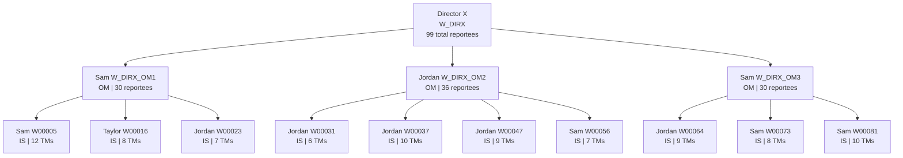

# EPMS organization chart: Director X

Source: [epms_sample_100_employees.csv](data/epms_sample_100_employees.csv).
Snapshot: **2026-11-06**. All employees are active; all reporting lines are
**SOLID**. The hierarchy is derived from each employee's `hierarchy_code`.

## Headcount

| Level | Employees |
|---|---:|
| Director (DIR) | 1 |
| Org Manager (OM) | 3 |
| Supervisor (IS) | 10 |
| Team Member (TM) | 86 |
| **Total including Director X** | **100** |

Director X has **99 reportees: 3 direct OMs and 96 indirect employees
(10 ISs + 86 TMs)**. Reportee counts exclude the named manager.
This expanded EPMS sample is separate from the original 88-employee baseline;
its counts do not describe the live Fabric model.

## Hierarchy overview

Open in a Mermaid-enabled Markdown preview to render the chart. Arrows point
**manager -> direct report**. Each IS box summarizes its team members; all
individual employees are listed in the full chart below.



### OM branch totals

| OM | Direct reports (IS) | Indirect reports (TM) | Total reportees excluding OM | Branch employees including OM |
|---|---:|---:|---:|---:|
| Sam W_DIRX_OM1 | 3 | 27 | 30 | 31 |
| Jordan W_DIRX_OM2 | 4 | 32 | 36 | 37 |
| Sam W_DIRX_OM3 | 3 | 27 | 30 | 31 |
| **Total across branches** | **10** | **86** | **96** | **99** |

## Full organization: all 100 employees

Each line represents one employee: `full_name [employee_id] (level)`.
Indentation identifies the immediate manager. Direct-report counts are shown
for managers. The 12 added team members have IDs `W_EPMS_TM001` through
`W_EPMS_TM012`. No dotted-line or external employees are included.

```text
Director X [W_DIRX] (DIR) | 3 direct reports
|-- Sam W_DIRX_OM1 [W_DIRX_OM1] (OM) | 3 direct reports
|   |-- Sam W00005 [W00005] (IS) | 12 direct reports
|   |   |-- Alex W00007 [W00007] (TM)
|   |   |-- Taylor W00008 [W00008] (TM)
|   |   |-- Alex W00009 [W00009] (TM)
|   |   |-- Alex W00010 [W00010] (TM)
|   |   |-- Alex W00011 [W00011] (TM)
|   |   |-- Sam W00012 [W00012] (TM)
|   |   |-- Sam W00013 [W00013] (TM)
|   |   |-- Alex W00014 [W00014] (TM)
|   |   |-- Sam W00015 [W00015] (TM)
|   |   |-- Sample Employee001 [W_EPMS_TM001] (TM)
|   |   |-- Sample Employee011 [W_EPMS_TM011] (TM)
|   |   `-- Alex W_TM_DEMO [W_TM_DEMO] (TM)
|   |-- Taylor W00016 [W00016] (IS) | 8 direct reports
|   |   |-- Taylor W00017 [W00017] (TM)
|   |   |-- Jordan W00018 [W00018] (TM)
|   |   |-- Alex W00019 [W00019] (TM)
|   |   |-- Sam W00020 [W00020] (TM)
|   |   |-- Taylor W00021 [W00021] (TM)
|   |   |-- Jordan W00022 [W00022] (TM)
|   |   |-- Sample Employee002 [W_EPMS_TM002] (TM)
|   |   `-- Sample Employee012 [W_EPMS_TM012] (TM)
|   `-- Jordan W00023 [W00023] (IS) | 7 direct reports
|       |-- Sam W00024 [W00024] (TM)
|       |-- Jordan W00025 [W00025] (TM)
|       |-- Alex W00026 [W00026] (TM)
|       |-- Alex W00027 [W00027] (TM)
|       |-- Taylor W00028 [W00028] (TM)
|       |-- Alex W00029 [W00029] (TM)
|       `-- Sample Employee003 [W_EPMS_TM003] (TM)
|-- Jordan W_DIRX_OM2 [W_DIRX_OM2] (OM) | 4 direct reports
|   |-- Jordan W00031 [W00031] (IS) | 6 direct reports
|   |   |-- Taylor W00032 [W00032] (TM)
|   |   |-- Alex W00033 [W00033] (TM)
|   |   |-- Taylor W00034 [W00034] (TM)
|   |   |-- Alex W00035 [W00035] (TM)
|   |   |-- Jordan W00036 [W00036] (TM)
|   |   `-- Sample Employee004 [W_EPMS_TM004] (TM)
|   |-- Jordan W00037 [W00037] (IS) | 10 direct reports
|   |   |-- Sam W00038 [W00038] (TM)
|   |   |-- Alex W00039 [W00039] (TM)
|   |   |-- Alex W00040 [W00040] (TM)
|   |   |-- Sam W00041 [W00041] (TM)
|   |   |-- Jordan W00042 [W00042] (TM)
|   |   |-- Alex W00043 [W00043] (TM)
|   |   |-- Sam W00044 [W00044] (TM)
|   |   |-- Alex W00045 [W00045] (TM)
|   |   |-- Taylor W00046 [W00046] (TM)
|   |   `-- Sample Employee005 [W_EPMS_TM005] (TM)
|   |-- Jordan W00047 [W00047] (IS) | 9 direct reports
|   |   |-- Jordan W00048 [W00048] (TM)
|   |   |-- Sam W00049 [W00049] (TM)
|   |   |-- Jordan W00050 [W00050] (TM)
|   |   |-- Jordan W00051 [W00051] (TM)
|   |   |-- Sam W00052 [W00052] (TM)
|   |   |-- Jordan W00053 [W00053] (TM)
|   |   |-- Alex W00054 [W00054] (TM)
|   |   |-- Sam W00055 [W00055] (TM)
|   |   `-- Sample Employee006 [W_EPMS_TM006] (TM)
|   `-- Sam W00056 [W00056] (IS) | 7 direct reports
|       |-- Taylor W00057 [W00057] (TM)
|       |-- Taylor W00058 [W00058] (TM)
|       |-- Jordan W00059 [W00059] (TM)
|       |-- Sam W00060 [W00060] (TM)
|       |-- Jordan W00061 [W00061] (TM)
|       |-- Alex W00062 [W00062] (TM)
|       `-- Sample Employee007 [W_EPMS_TM007] (TM)
`-- Sam W_DIRX_OM3 [W_DIRX_OM3] (OM) | 3 direct reports
    |-- Jordan W00064 [W00064] (IS) | 9 direct reports
    |   |-- Jordan W00065 [W00065] (TM)
    |   |-- Alex W00066 [W00066] (TM)
    |   |-- Sam W00067 [W00067] (TM)
    |   |-- Jordan W00068 [W00068] (TM)
    |   |-- Sam W00069 [W00069] (TM)
    |   |-- Taylor W00070 [W00070] (TM)
    |   |-- Taylor W00071 [W00071] (TM)
    |   |-- Taylor W00072 [W00072] (TM)
    |   `-- Sample Employee008 [W_EPMS_TM008] (TM)
    |-- Sam W00073 [W00073] (IS) | 8 direct reports
    |   |-- Sam W00074 [W00074] (TM)
    |   |-- Sam W00075 [W00075] (TM)
    |   |-- Jordan W00076 [W00076] (TM)
    |   |-- Taylor W00077 [W00077] (TM)
    |   |-- Taylor W00078 [W00078] (TM)
    |   |-- Jordan W00079 [W00079] (TM)
    |   |-- Sam W00080 [W00080] (TM)
    |   `-- Sample Employee009 [W_EPMS_TM009] (TM)
    `-- Sam W00081 [W00081] (IS) | 10 direct reports
        |-- Taylor W00082 [W00082] (TM)
        |-- Alex W00083 [W00083] (TM)
        |-- Alex W00084 [W00084] (TM)
        |-- Alex W00085 [W00085] (TM)
        |-- Sam W00086 [W00086] (TM)
        |-- Sam W00087 [W00087] (TM)
        |-- Taylor W00088 [W00088] (TM)
        |-- Alex W00089 [W00089] (TM)
        |-- Taylor W00090 [W00090] (TM)
        `-- Sample Employee010 [W_EPMS_TM010] (TM)
```
