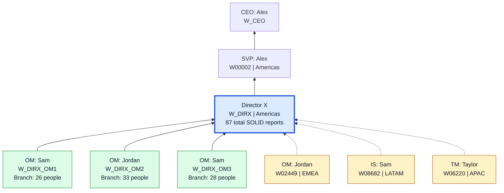
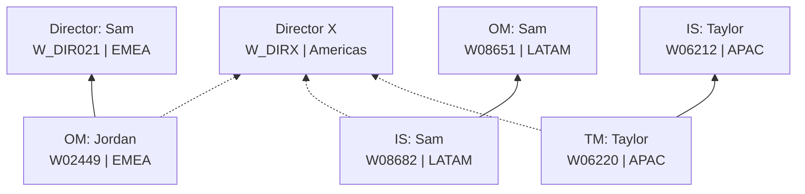
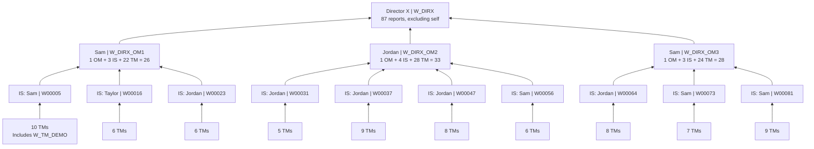
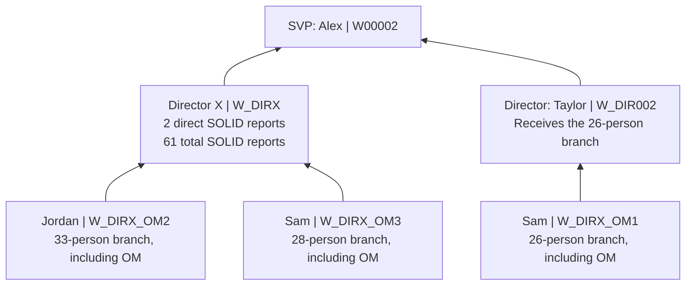

# Sample organizational structure: Director X

Baseline from [notebook 01](notebooks/01_generate_workday_data.py), random seed **42**,
before the re-org. This is derived from the generator, not a live Fabric workspace
snapshot. The charts focus on Director X rather than drawing all 10,000 workers.

Open this file in Markdown Preview in VS Code (`Ctrl+Shift+V`) or on GitHub.
Mermaid-enabled previews render the diagrams; the tables remain readable without it.

## Legend and headline counts

- **Solid arrow:** current SOLID reporting line.
- **Dotted arrow:** current DOTTED / cross-region matrix reporting line.
- Arrows point **worker -> manager**, matching the Fabric graph. Managers appear
  above their reports.
- Team-member boxes in the detailed chart are grouped counts, not single workers.
- Unrelated branches and dotted lines not directly connected to Director X are omitted.

| Director X metric | Before re-org | After re-org |
|---|---:|---:|
| Direct SOLID reports | 3 | 2 |
| Full SOLID subtree, excluding Director X | 87 | 61 |
| Direct DOTTED reports, counted separately | 3 | 3 |

The **87** SOLID reports are **3 OMs + 10 ISs + 74 TMs**.
The three DOTTED reports do **not** belong to that SOLID subtree.

## 1. Direct reports and dotted-line reports



Only the **three green OMs** are Director X's direct SOLID reports.
The yellow workers have their own SOLID managers elsewhere:

| Dotted report's full_name | Level | Region | SOLID manager's full_name | DOTTED manager |
|---|---|---|---|---|
| Jordan W02449 | OM | EMEA | Sam W_DIR021 | Director X |
| Sam W08682 | IS | LATAM | Sam W08651 | Director X |
| Taylor W06220 | TM | APAC | Taylor W06212 | Director X |

### Both reporting lines for the same workers



Each yellow worker in the first chart has **one SOLID manager and one separate
DOTTED manager**, not two SOLID managers.

## 2. Full SOLID organization under Director X



### Team-member IDs behind each grouped box

Ranges below are inclusive and refer to numeric worker IDs, not generated names.

| OM | Immediate Supervisor | TM count | TM worker IDs |
|---|---|---:|---|
| W_DIRX_OM1 | W00005 | 10 | W_TM_DEMO; W00007-W00015 |
| W_DIRX_OM1 | W00016 | 6 | W00017-W00022 |
| W_DIRX_OM1 | W00023 | 6 | W00024-W00029 |
| W_DIRX_OM2 | W00031 | 5 | W00032-W00036 |
| W_DIRX_OM2 | W00037 | 9 | W00038-W00046 |
| W_DIRX_OM2 | W00047 | 8 | W00048-W00055 |
| W_DIRX_OM2 | W00056 | 6 | W00057-W00062 |
| W_DIRX_OM3 | W00064 | 8 | W00065-W00072 |
| W_DIRX_OM3 | W00073 | 7 | W00074-W00080 |
| W_DIRX_OM3 | W00081 | 9 | W00082-W00090 |
| **Total** | **10 supervisors** | **74** | |

Sample full chain, in the graph's edge direction:

```text
W_TM_DEMO -> W00005 -> W_DIRX_OM1 -> W_DIRX -> W00002 -> W_CEO
TM          IS        OM            Director  SVP        CEO
```

## 3. Re-org: move OM1's entire branch

[Notebook 02](notebooks/02_simulate_reorg.py) changes only OM1's SOLID parent.
The **3 ISs and 22 TMs** underneath OM1 stay attached to the same managers.

| Relationship | Before | After |
|---|---|---|
| W_DIRX_OM1 SOLID manager | W_DIRX | W_DIR002 |
| W_DIRX_OM2 SOLID manager | W_DIRX | W_DIRX |
| W_DIRX_OM3 SOLID manager | W_DIRX | W_DIRX |
| Three direct DOTTED reports to W_DIRX | Unchanged | Unchanged |

After the re-org:



Director X's new rollup is **33 + 28 = 61**, or **87 - 26 = 61**.
The new breakdown is **2 OMs + 7 ISs + 52 TMs**.
Director W_DIR002's pre-existing reports are omitted from this change-only chart.
Refresh the Fabric graph after running notebook 02 to make agent answers reflect this change.

## Whole-company context

| Level | Worker count |
|---|---:|
| CEO | 1 |
| SVP | 4 |
| Director | 80 |
| OM | 240 |
| IS | 958 |
| TM | 8,717 |
| **Total** | **10,000** |

There are **9,999 current SOLID lines** and **500 current DOTTED lines**
across the company. The charts above show only the Director X demo slice.
